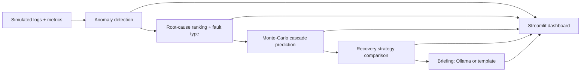

# 🛡️ CascadeGuard
**AI system that predicts cascading software failures, finds their root cause, and recommends the best recovery strategy - before the whole system crashes.**
*Orca Coder · Track 01 – Software & AI*

## The problem
Modern apps are many small services that depend on each other. When one breaks (say a database slows down), everything that depends on it starts timing out and retrying, and fails too - a **cascading failure**. Teams usually notice only after the crash, and waste time on the loudest symptom instead of the real cause.

## What CascadeGuard does
| Step | Module | What it does | How |
|---|---|---|---|
| 1 Simulate | `simulator.py` | Generates metrics + logs for 12 services and injects one hidden fault | dependency graph + delayed degradation model |
| 2 Detect | `detection.py` | Which services are abnormal, and since when? | z-score vs. learned baseline, must persist 2 min |
| 3 Root cause | `rootcause.py` | Which service started it, and what kind of fault? | score = earliness + graph coverage + healthy deps + own-error share; fault type from log keywords & metric signature |
| 4 Predict | `propagation.py` | Which services fail next, and in how many minutes? | 1000-run Monte-Carlo cascade on the dependency graph |
| 5 Recommend | `recovery.py` | Best recovery action | re-simulate the cascade under each strategy; pick lowest damage |
| 6 Explain | `explain.py` | Plain-English incident briefing | local LLM (Ollama) **or** built-in template |
| UI | `app.py` | Live dashboard | Streamlit |



## Run it (2 minutes, no Ollama needed)
```bash
git clone <this-repo> && cd cascadeguard
python -m venv .venv && source .venv/bin/activate     # Windows: .venv\Scripts\activate
pip install -r requirements.txt
streamlit run app.py
```
Terminal-only version: `python run_cli.py --root orders-db --fault db_slowdown`
Tests: `python -m pytest -q`

### Using it
1. The sidebar picks the **hidden** broken service and fault type (the AI is not told).
2. Keep "Observe 6 minutes after the fault starts": only the root is failing, so the system must *predict* the rest.
3. Walk through the tabs: Overview → Root cause → Prediction → Recovery → Explanation → Validation (reveals the truth).
4. Change the fault type: the recommended action changes (failover for DB slowdown, restart for memory leak, scale-out for CPU, rollback for a bad deploy).

## Ollama is optional
The LLM **only narrates** facts the code already computed; it never decides anything.
- **Ollama installed** → real LLM briefing (`ollama pull llama3.2`, then press *Generate briefing*). Any installed model is used if the default isn't found.
- **No Ollama / not running / slow** → the app silently falls back to a deterministic template with the same content. The sidebar shows which engine is active.
- Override with env vars `OLLAMA_HOST`, `OLLAMA_MODEL`.

## Honest limitations
- **Data is simulated** (the problem statement allows this). The 100 % root-cause hit rate on our 60 simulated scenarios shows the modules agree with each other, **not** real-world accuracy.
- Strategy effectiveness numbers in `recovery.py` are **expert priors**, shown in the UI, not measured values.
- Propagation probabilities (`gain × weight²`) are hand-set, not learned from production traces.
- Next step: validate on real traces (e.g. RCAEval / Loghub) and learn dependency weights from data.

## Project layout
```
app.py                 Streamlit dashboard
run_cli.py             terminal demo
cascadeguard/          topology, simulator, detection, rootcause, propagation, recovery, explain, pipeline, viz
tests/test_pipeline.py 26 tests
docs/DEMO_SCRIPT.md    script for the demo video
```
